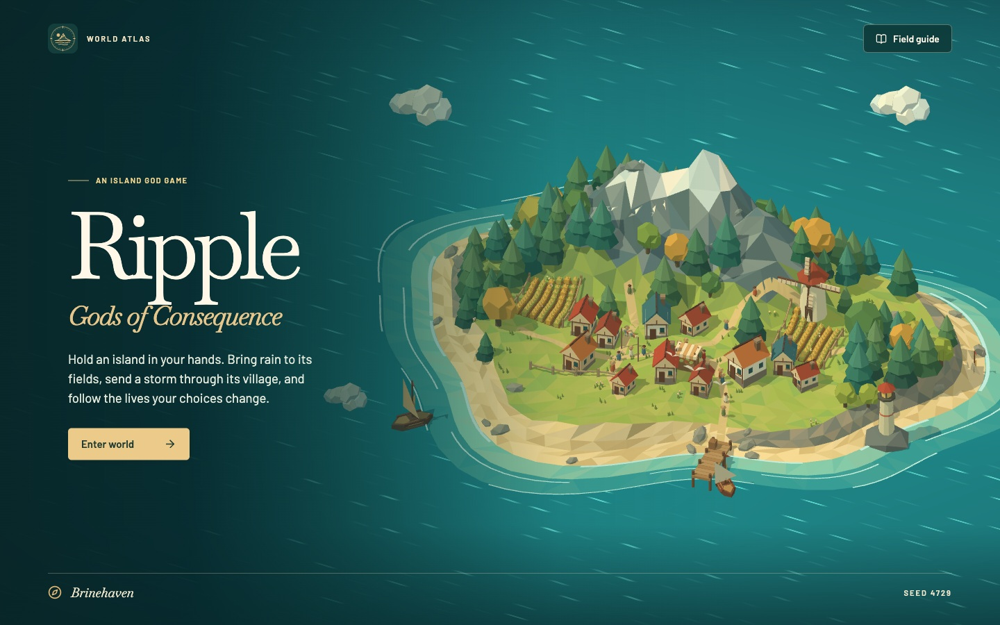
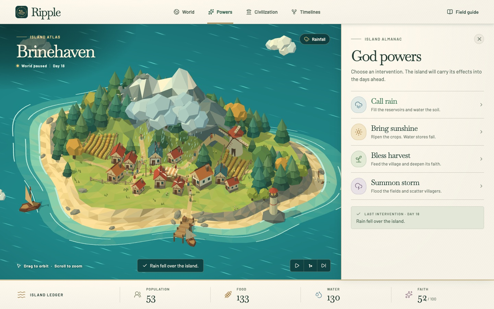
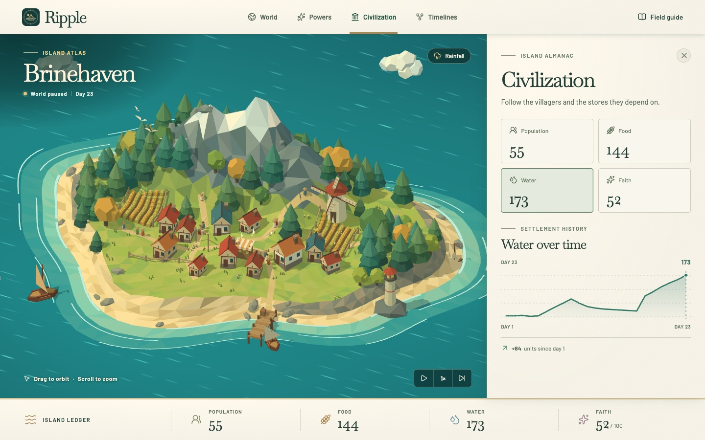

<p align="center"></p>
<h1 align="center">Ripple · Gods of Consequence</h1>
<p align="center">An island god game about weather, small decisions, and the people who live with them.</p>
<p align="center"><strong><a href="https://ripple-gods-of-consequence.onrender.com">Play Live Demo</a></strong></p>
<p align="center"><a href="https://webassembly.org/"></a></p>


Brinehaven's villagers need water to raise their crops. Sunshine can fill the granary while it drains the cistern. Call rain today and watch the next few harvests, or fork the island's history and see what a storm would have cost.

## Arrive at Brinehaven

Enter the world from the main menu. The island opens with seventeen simulated days already in its ledger. Drag the map to find the village, then pause the clock to take a closer look. The game saves the settlement in your browser after each change.



## Change the weather

Call rain to replenish water, bring sunshine to ripen crops, bless the harvest to increase food and faith, or summon a storm. Each power changes the settlement immediately and sets the weather for several days. The island ledger shows what the village has left to work with.



## Read the settlement history

Open **Civilization** and select population, food, water, or faith. Move across the chart to inspect a day. The ledger keeps up to sixty days, so you can see when a shortage began and how long the village took to recover.



## Follow the other timeline

Open **Timelines**, choose **Create a branch**, and give it one intervention. **Compare outcomes** runs both futures for seven days from the same snapshot. The table shows the differences at the end of the week. Change the chart's measure to see when the two histories diverged. Your live settlement keeps its own history.


## Run locally

Use Bun 1.3.10 and Node.js 24. The repository includes the compiled simulation.

```sh
git clone https://github.com/dylangrijalva/ripple-gods-of-consequence.git
cd ripple-gods-of-consequence
bun install --frozen-lockfile
bun run dev
```

Open the local address printed by Vite. For a production build, run `bun run build` followed by `bun start`. Bun serves the game at `http://localhost:3000`. Set `PORT` to change the port.

## Controls

| Input | Action |
| --- | --- |
| Drag the island | Orbit the camera |
| Scroll | Zoom in or out |
| **1**, **2**, **3**, **4** | Open World, Powers, Civilization, or Timelines |
| **Space** | Pause or resume the simulation while the map has focus |
| **.** | Advance one day |
| **Esc** | Close the guide, return to the map, or return to the main menu |
| **?** | Open the field guide |
| Click the speed multiplier | Cycle through 1×, 2×, and 4× speed |
| Arrow keys on a focused chart slider | Inspect an earlier or later day |

## How it works

| Layer | Responsibility |
| --- | --- |
| Bun | Serves the built client, the Wasm binary, and the island name and seed at `GET /api/world`. Render runs the production Docker image. |
| Rust and WebAssembly | Calculate each day's weather, harvest, consumption, population, and faith. The browser passes a complete island snapshot into each transition, so two branches can evolve independently. |
| React and TypeScript | Manage the clock, the sixty-day chronicle, browser saves, the almanac, and timeline comparisons. |
| Three.js | Builds and lights the island from seeded geometry, animates the settlement, and draws interventions in the world. |

## Test and capture

```sh
bun test                        # Bun server and shipped Wasm
bun run build                   # Type-check and build production assets
bunx playwright install chromium
bun run test:e2e                # Desktop gameplay and a phone-sized viewport
bun run screenshots             # Capture the five README images at 1440 × 900
```

The browser checks start a local production server. To exercise a deployment, set `GAME_URL` to its origin before running the tests or screenshot command. Playwright waits for the game and fonts to load and operates the same controls as a player.

For simulation development, install Rust with rustup. The toolchain and WebAssembly target are pinned in `sim/rust-toolchain.toml`.

```sh
(cd sim && cargo test --locked)
sh sim/build.sh
git diff --exit-code -- public/simulation.wasm
```

The last command checks whether rebuilding changes the shipped binary. When changing the simulation, commit the updated binary alongside its Rust source.

## Roadmap

- Save named timeline branches and reopen them across sessions.
- Add island seeds with different coastlines and starting settlements.
- Let players follow individual households through a shortage and its recovery.
