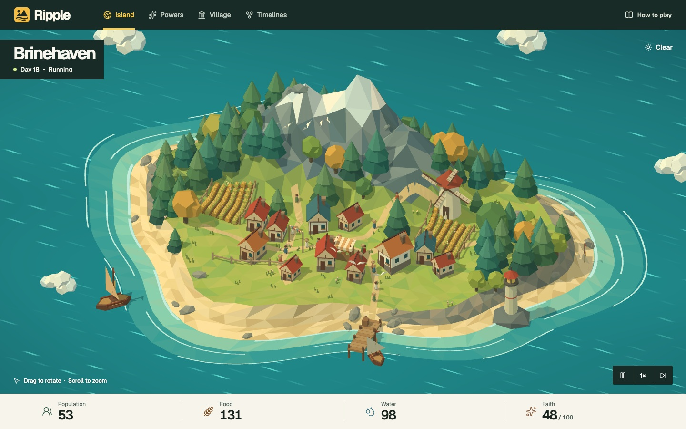
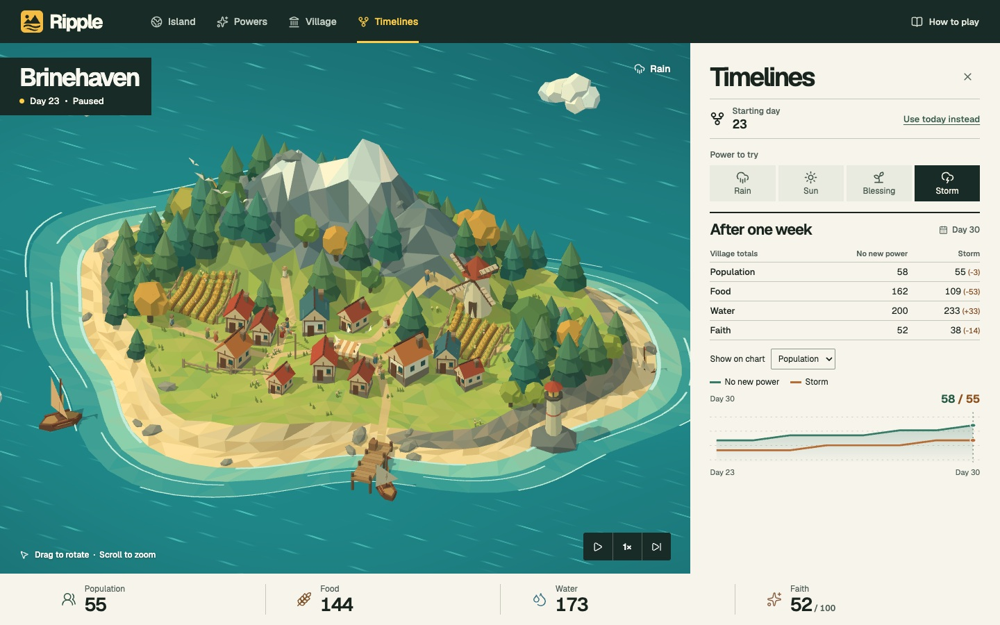

<p align="center"></p>
<h1 align="center">Ripple · Gods of Consequence</h1>
<p align="center">Brinehaven grows its own food. As the island's god, you can send rain when the fields start to dry out.</p>
<p align="center"><strong><a href="https://ripple-gods-of-consequence.onrender.com">Play Live Demo</a></strong></p>
<p align="center"><a href="https://webassembly.org/"></a></p>



## Your first day

You arrive in Brinehaven on day 18. There are 53 people on the island and 98 units of water in the cistern. Pause the clock and drag the island around to look at the farms behind the village. When you come back, the game picks up from the last day saved in this browser.


## Rain or shine?

If you call rain on that first day, the cistern jumps from 98 to 130 and the fields get five days of rain. Sunshine brings in more food right away, at the cost of some water. A harvest blessing raises food stores and faith. A storm brings water too, but it costs the village crops and lives.


## Village records

Open Village when food runs low. A look at the water chart can help explain a poor harvest. Farmers bring in less food when the cistern is nearly empty. You can trace food, water, population or faith for the past 60 days. Select a measure and move along its chart to read the value on a particular day.


## Try a storm on a branch

Open Timelines and start a branch from today's village. Send the branch a storm, then run one week to see what happens. The other village goes through the same week with its usual weather. Read down the columns to see how much food each village has left and how many people live there. You can also plot the days in between. Both forecasts run separately from your saved island.



## Local setup

Use Bun 1.3.10 and Node.js 24. The compiled simulation ships with the game.

```sh
git clone https://github.com/dylangrijalva/ripple-gods-of-consequence.git
cd ripple-gods-of-consequence
bun install --frozen-lockfile
bun run dev
```

Vite prints the address to open in your browser. To serve the production version, run `bun run build`, then `bun start`. The default address is `http://localhost:3000`. You can choose another port with `PORT`.

## Controls

| Input | Action |
| --- | --- |
| Drag | Turn the island |
| Scroll | Zoom |
| 1, 2, 3, 4 | Open Island, Powers, Village or Timelines |
| Space | Pause or resume time with the map in focus |
| Period (.) | Step forward one day |
| Esc | Close the guide or panel. On the map, return to the title screen. |
| ? | Open How to play |
| Click the clock speed | Switch between 1×, 2× and 4× |
| Arrow keys with the chart slider in focus | Read the previous or next day |

## Inside the game

Bun serves the client and its Wasm file from one Docker container on Render. The browser gets Brinehaven's name and seed from `GET /api/world`. Three.js uses the seed to build and light the island, and animates the villagers and the weather you call down.

Rust handles the daily harvest, water use and population changes. It runs in the browser through WebAssembly. Each turn takes a full copy of the village's state, including the weather and faith. Two branches can start with the same village and carry on independently from that turn.

React and TypeScript run the clock and keep the last 60 days in browser storage. Those daily records supply the charts and the starting point for a branch.

## Tests and screenshots

```sh
bun test                        # Bun server and shipped Wasm
bun run build                   # Type-check and build production assets
bunx playwright install chromium
bun run test:e2e                # Desktop gameplay and a phone-sized viewport
bun run screenshots             # Capture the five README images at 1440 × 900
```

Playwright starts the production build locally, opens the game and plays through both screen sizes. For screenshots, it waits for the island and fonts to finish loading. Set `GAME_URL` to a deployed game's origin to run the same checks or capture screenshots there.

To work on the simulation, install Rust with rustup. The build reads its toolchain version and WebAssembly target from `sim/rust-toolchain.toml`.

```sh
(cd sim && cargo test --locked)
sh sim/build.sh
git diff --exit-code -- public/simulation.wasm
```

The last command reports any difference between your build and the committed Wasm file. If you change the Rust simulation, commit the rebuilt binary with it.

## Roadmap

- Name a branch and pick it up again next time you play.
- Explore other coastlines with villages of different starting sizes.
- Follow a household through a food shortage and see how it fares when supplies return.
